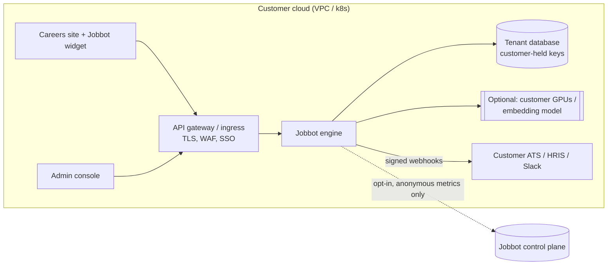
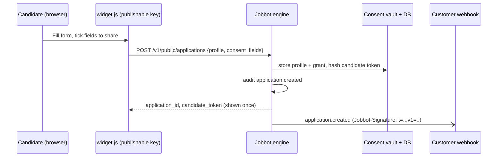
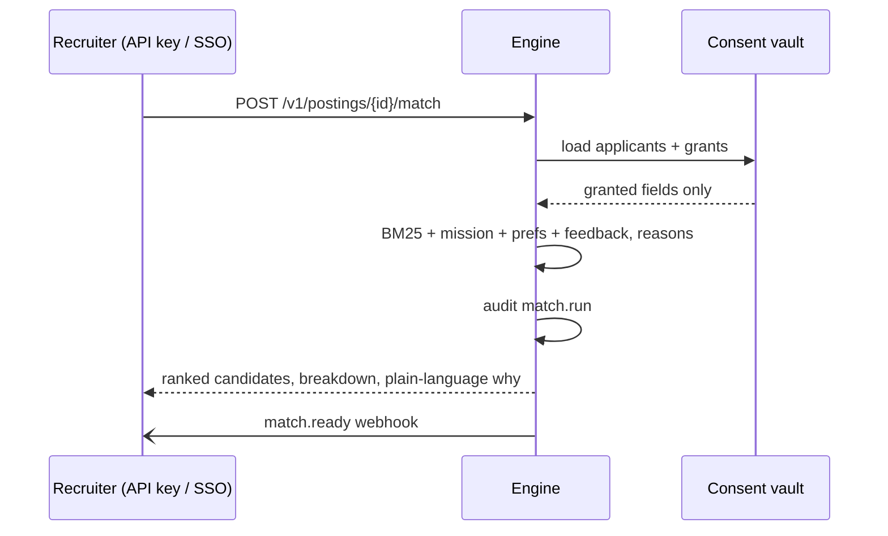

<!-- Copyright (c) 2026 Benjamin Stanley Frohman. All rights reserved. Proprietary and confidential. -->
# Jobbot Enterprise: architecture

Jobbot Enterprise is a packaged hiring engine (backend plus embeddable frontend) that a company, such as a frontier AI lab, deploys **inside its own infrastructure**. The company keeps every candidate record. Jobbot supplies the engine, upgrades and operational know-how, so the company doesn't have to build matching, consent, intake and audit itself.

Status legend: **[v0.1]** works in this repository today; **[planned]** is designed here but not built yet.

## 1. Tenancy model

| Mode | Where data lives | What Jobbot sees |
|------|------------------|------------------|
| **Single-tenant self-hosted** (default) [v0.1] | Customer VPC / Kubernetes namespace, customer volume or database | Nothing. No phone-home. |
| **Optional managed control plane** [planned] | Same as above | Only anonymous metadata the customer opts into: engine version, health, counts, latency, and score distributions with no candidate identifiers |

Inside one deployment the engine is still multi-tenant: every row carries `tenant_id`, every query filters on it, and API keys belong to exactly one tenant. This lets a holding company run several brands or business units on one install without them seeing each other's data. Tests cover this.

## 2. Components

| Component | Role | Status |
|-----------|------|--------|
| API gateway | TLS termination, WAF, SSO session, rate limits at the edge. Provided by the customer's ingress; the engine has its own per-key rate limits too | customer-provided; engine limits [v0.1] |
| Intake service | Public application endpoint used by the widget: validates input, stores the profile and consent grant, issues a candidate self-service token, emits `application.created` | [v0.1] |
| Matching service | Local explainable ranking (BM25 skills fit + mission fit + preferences + recruiter feedback). Pluggable `Embedder` interface for customer models | [v0.1] (BM25); embeddings interface [v0.1], GPU adapters [planned] |
| Candidate consent vault | Stores each candidate's grant (which fields the company may see or score). Every staff view and every match reads only granted fields | [v0.1] (field-level); per-field encryption with tenant keys [planned] |
| Admin console | Web UI for postings, pipelines, keys, webhooks and audit | API [v0.1]; UI [planned] |
| Embeddable widgets | `widget.js` careers board + apply form with a consent picker, configured per tenant | [v0.1] |
| Webhooks | HMAC-SHA256 signed events with replay window and retries; delivery log | [v0.1] |
| Audit log | Append-only, hash-chained per tenant; JSON / JSONL export | [v0.1] |

## 3. Data flows

### Application intake

### Ranking with consent

### Candidate control

A candidate uses their token to read their own full record, narrow or widen what the company sees (`PUT /v1/candidate/me/consent`), or erase themselves (`DELETE /v1/candidate/me`). Narrowing takes effect immediately: the next staff view or match no longer includes the withdrawn fields.

## 4. Security

- **Keys and auth** [v0.1]: tenant API keys with roles `admin`, `recruiter`, `auditor` and `widget` (publishable, public surface only). Only SHA-256 hashes are stored, and keys can be revoked. Operator token is required to create tenants.
- **SSO / OIDC** [planned]: the engine accepts OIDC ID/access tokens from the customer's IdP (Okta, Entra, Google). Group claims map to the same roles. Until then, put SSO at the gateway and give the console a recruiter key.
- **RBAC** [v0.1]: scope checks on every staff endpoint (see `auth.ROLES`).
- **Tenant-held encryption keys** [planned]: envelope encryption of candidate profiles with a data key wrapped by the customer's KMS (AWS KMS / GCP KMS / Vault). Jobbot never holds the key. v0.1 relies on encrypted volumes provided by the customer.
- **Audit log** [v0.1]: every mutation and every candidate view is recorded with actor, target and detail. Entries are hash-chained so tampering is detectable (`chain_valid`).
- **Data residency** [v0.1]: data never leaves the customer's deployment. Each tenant records a `region`, and deploying per region keeps data in-region.
- **Retention and deletion** [v0.1]: per-tenant `retention_days` plus `POST /v1/retention/run` erases expired candidate profiles. Candidates can erase themselves.
- **Webhooks** [v0.1]: https only by default, signed `t=<unix>,v1=<hmac>` over `t.body`, 5-minute replay tolerance, secret shown once.
- **Container** [v0.1]: non-root user, read-only root filesystem, all capabilities dropped, `no-new-privileges`, bound to localhost behind your ingress.

## 5. Compute

- Default: **local CPU scoring**, with no external AI calls and no GPU needed. Thousands of applicants rank in milliseconds.
- Pluggable: implement `matching.Embedder.sims(query, docs)` to blend in semantic similarity from a model the customer runs (sentence-transformers on their GPUs, an internal embedding service, or a self-hosted LLM). Candidate data still never leaves their network. [interface v0.1, adapters planned]
- Scale-out [planned]: Postgres backend and stateless engine replicas behind the gateway. The webhook worker moves to a queue.

## 6. Candidate consent model

- Fields: `name, email, phone, location, links, skills, experience, values, causes, desired_impact, comp_expectation, resume_text`.
- The candidate picks the grant at apply time (the widget pre-ticks the tenant's `default_consent`, and the candidate can untick anything).
- Staff views return **only** granted fields. Withheld fields are omitted, not blanked, so their existence isn't leaked.
- Matching scores **only** granted fields from the matchable set. A withheld skill can never help or hurt a candidate.
- Grants can change at any time and are audited (`consent.updated` event + webhook).

## 7. Fairness and compliance considerations

> These are engineering considerations, **not legal advice**. Customers should involve their own counsel.

- **Bias audits**: scores are explainable (`breakdown` + `reasons`). Planned: a bias-audit export of selection rates and impact ratios by self-reported category, collected separately with its own consent and never used in scoring.
- **US EEOC / Title VII**: avoid disparate impact. Don't add protected attributes, or obvious proxies, to the matchable fields. Human review is expected; the engine ranks and does not decide.
- **NYC Local Law 144 (AEDTs)**: if a ranking "substantially assists" hiring decisions for NYC roles, an independent bias audit, a public summary and candidate notice may be required. The consent screen and audit export are meant to support that.
- **EU AI Act**: AI systems used for recruitment are listed as high-risk. Relevant duties include risk management, data governance, logging, transparency to candidates, human oversight, and accuracy and robustness documentation. Self-hosting, explanations and the audit log help, but the deployer still has obligations.
- **GDPR / CCPA**: covered by data minimization through consent, access (`/candidate/me`), erasure, retention limits and in-region deployment. A DPA between the customer and Jobbot covers support access only.
